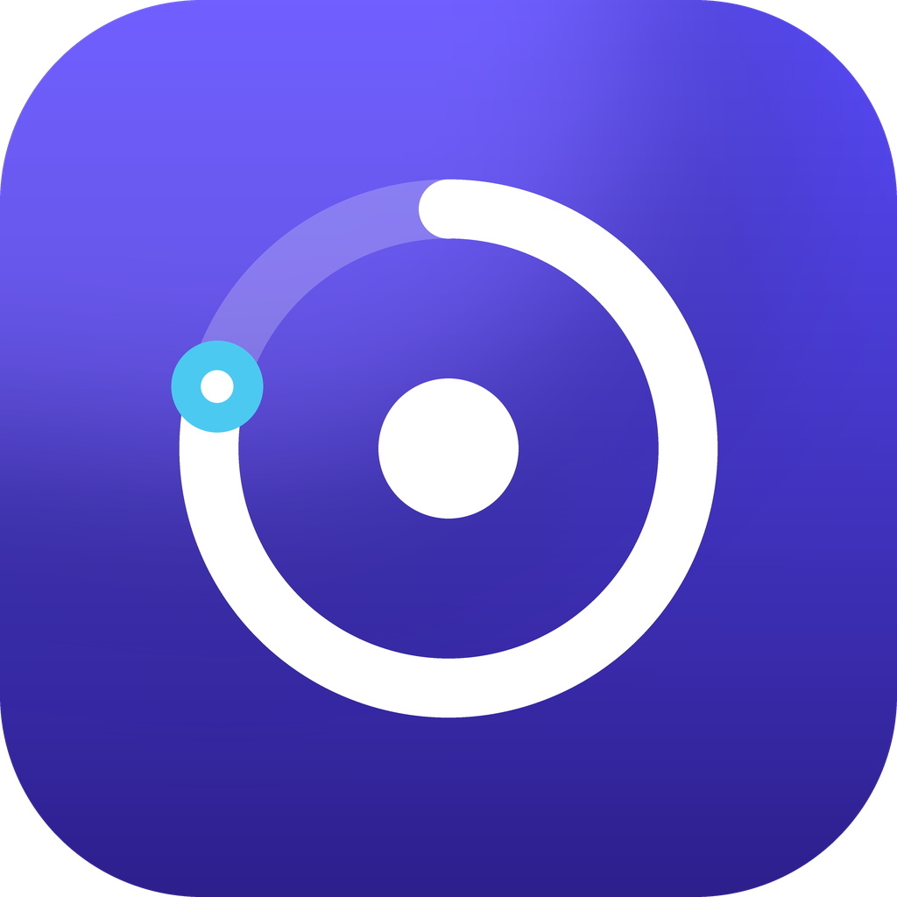

<p align="center">
  
</p>

<h1 align="center">Sumera Pomodoro</h1>

<p align="center">Odaklan. Dinlen. İlerlemeni gör.</p>

## Özellikler

- **Zamanlayıcı:** çalışma / kısa mola / uzun mola, ayarlanabilir süreler ve uzun mola sıklığı,
  otomatik geçiş ve otomatik başlatma, atlama ve sıfırlama
- **Doğru sayaç:** bitiş saatine göre çalışır; arka planda ya da uygulama kapatıldığında bile
  süre kaymaz, açıldığında kaldığı yerden devam eder
- **Bildirim:** süre bitince zamanlanmış bildirim (uygulama kapalıyken de gelir), titreşim
- **İstatistikler:** son 7 / 30 günün odak süresi grafiği, toplam ve ortalama süre,
  pomodoro sayısı, gün serisi, görevlere göre dağılım
- **Görevler:** odak görevi seçme, pomodoroların göreve yazılması, kaydırarak silme ve geri alma
- **Günlük hedef**, ekranı açık tutma, sistem/Türkçe/İngilizce dil seçimi
- **Uzaktan yönetim:** duyurular, günün sözü, metinler, varsayılan ayarlar, özellik açma/kapama ve
  güncelleme uyarıları mağaza güncellemesi olmadan değiştirilebilir (bkz. aşağıda)
- Kişisel veriler yalnızca cihazda saklanır; hesap ve reklam yoktur

## Proje yapısı

```
lib/
  main.dart                  Başlatma
  src/app.dart               MaterialApp ve alt gezinme çubuğu
  src/controller.dart        Sayaç, görevler, geçmiş ve istatistik hesapları
  src/models.dart            Ayarlar, görev ve oturum modelleri
  src/services.dart          Kalıcı depolama ve bildirimler
  src/remote_config.dart     GitHub'dan okunan uzaktan ayarlar
  src/strings.dart           Türkçe / İngilizce metinler
  src/brand.dart             Renkler ve tema
  src/widgets.dart           Grafik, zamanlayıcı halkası ve ortak bileşenler
  src/screens/               Zamanlayıcı, İstatistik, Görevler, Ayarlar
remote/config.json          Yayındaki uygulamaların okuduğu uzaktan ayar dosyası
store/                       Play Store görselleri, mağaza metinleri, gizlilik politikası
```

## Geliştirme

```bash
flutter pub get
flutter test
flutter run
```

### Windows'ta Türkçe karakterli klasör yolu

Proje yolu `İ`, `ş`, `ğ` gibi karakterler içeriyorsa Flutter'ın shader derleyicisi
`Could not write file ... ink_sparkle.frag` hatası verir. Projeye ASCII bir sürücü harfi atayın:

```powershell
subst P: "C:\Users\SUEDA TEKİN\source\repos\pomodoro"
cd P:\
flutter run
```

İşiniz bitince `subst P: /D` ile eşlemeyi kaldırın.

## Yayından sonra değişiklik yapmak

İki yol vardır:

1. **Uzaktan ayar dosyası (anında, mağaza onayı yok):** `remote/config.json` dosyasını GitHub'da
   düzenleyin. Duyuru, günün sözü, uygulamadaki her metin, varsayılan süreler, özellikleri
   açma/kapama ve "güncelleme var / zorunlu güncelleme" uyarıları birkaç dakika içinde tüm
   kullanıcılara ulaşır. Ayrıntılar: [`remote/README.md`](remote/README.md)
2. **Yeni sürüm (kod değişiklikleri):** yeni ekran/özellik/hata düzeltmesi için `pubspec.yaml`
   ve `kAppVersion` sürümünü artırıp yeni `.aab` yükleyin. Ardından `remote/config.json` içinde
   `latestVersion` değerini yeni sürüme çekerek eski sürümdeki kullanıcılara "Güncelle" kartı gösterin.

## Play Store'a yayınlama

### 1. Yükleme anahtarı (bir kez)

```powershell
keytool -genkey -v -keystore C:\keys\sumera-upload.jks -keyalg RSA -keysize 2048 -validity 10000 -alias upload
```

`android/key.properties` dosyasını oluşturun (bu dosya git'e eklenmez):

```properties
storePassword=<şifre>
keyPassword=<şifre>
keyAlias=upload
storeFile=C:/keys/sumera-upload.jks
```

> `.jks` dosyasını ve şifreleri güvenli bir yerde yedekleyin. Bu dosya olmadan
> `key.properties` yoksa release derlemeleri debug anahtarıyla imzalanır ve Play Console kabul etmez.

### 2. App Bundle oluşturma

Her yeni sürümde `pubspec.yaml` içindeki `version: 1.0.0+1` değerini artırın
(`+` sonrası sayı her yüklemede büyümelidir) ve `lib/src/brand.dart` içindeki `kAppVersion`'ı güncelleyin.

```powershell
flutter build appbundle --release
```

Çıktı: `build/app/outputs/bundle/release/app-release.aab`

### 3. Mağaza kaydı

`store/` klasöründe hazır olanlar:

- `icon-512.png` – mağaza simgesi
- `feature-graphic.png` – öne çıkan görsel (1024×500)
- `listing.md` – uygulama adı, kısa ve tam açıklama (TR/EN), kategori ve form önerileri
- `privacy-policy.md` – gizlilik politikası; herkese açık bir sayfada yayınlayıp bağlantısını girin

Uygulama kimliği: `com.sumera.pomodoro` (Play'e ilk yüklemeden sonra değiştirilemez).
